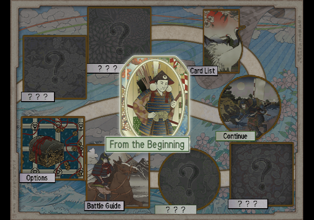
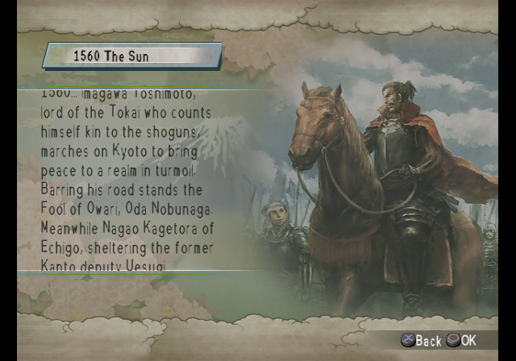
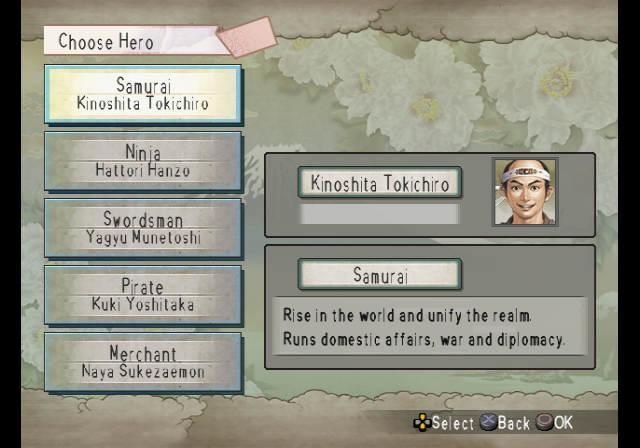
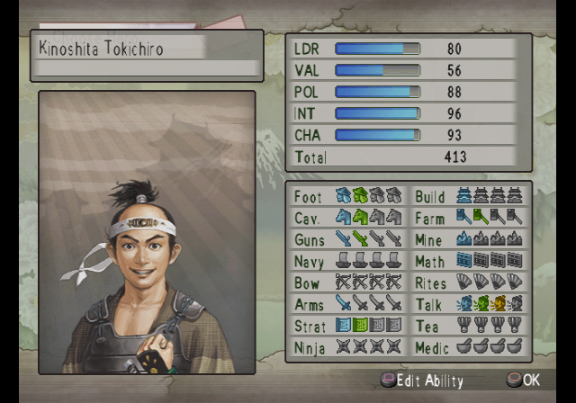
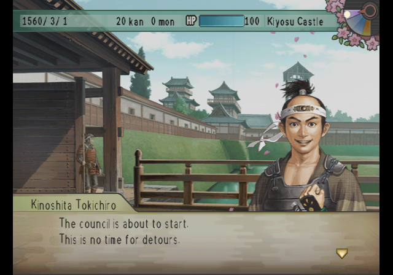
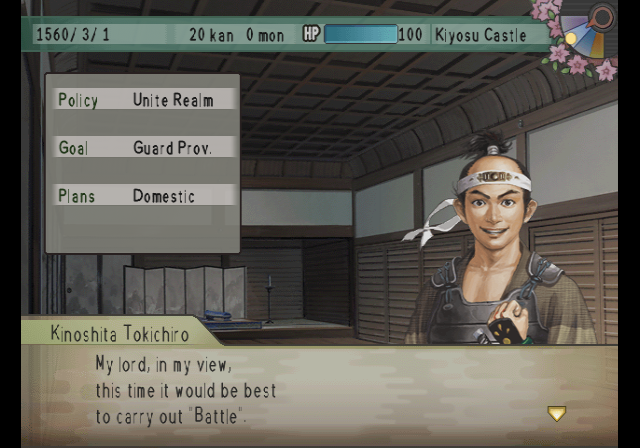
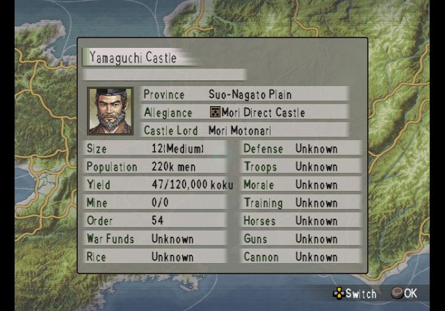
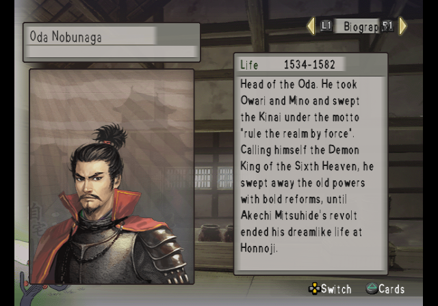
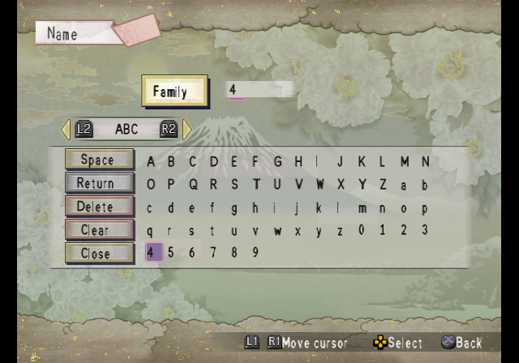

# Taiko Risshiden V — English Translation

A fan translation of **Taiko Risshiden V** (太閤立志伝V, Koei, 2004) for the
PlayStation 2 into English. Taiko Risshiden is Koei's Sengoku-era life simulation:
you live as a samurai, merchant, ninja, swordsman or pirate and rise in the world.
The game was only released in Japan.

> **This is a full machine translation.** All of the game's text was translated from
> Japanese by an AI model, not by a human translator, and it has not been
> proofread by a fluent Japanese speaker. Expect occasional mistranslations, awkward
> phrasing and inconsistent terms. Corrections are welcome.

> **This is a beta.** All of the game's text is now in English, including the story
> event scenes, but the event scenes have not been played through much yet. Expect
> text that overflows its window, odd line breaks or untested scenes.

> **Check which disc you have before downloading.** The game exists in two Japanese
> editions, and each patch works with **only one** of them. See the table below.

## Which version for which disc

| Your disc | Serial | Patch versions that work |
|---|---|---|
| **Koei the Best** re-release (2005) | `SLPM-66267` | **v0.11.0 and later** |
| Standard edition, original release (2004) | `SLPM-65674` | **v0.9 to [v0.10.3](https://github.com/damon-daemon/taiko-risshiden-5-english/releases/tag/v0.10.3)** (v0.10.3 is the last one) |

- A patch made for one edition **will not apply** to the other: the xdelta tool refuses it
  or produces a broken image. There is no patch that covers both.
- New fixes and translation work only go into the Koei the Best patches. The standard
  edition stays on v0.10.3.
- The Koei the Best edition is recommended. It fixes bugs of the first printing, for
  example the Date succession event that does not fire in 1582.
- **How to tell them apart:** the serial is printed on the disc and on the case spine.
  The Koei the Best edition has the "Koei the Best" logo on its cover. In a disc image,
  the file `SYSTEM.CNF` names the program: `SLPM_662.67` is Koei the Best, `SLPM_656.74`
  is the standard edition. The checksums of both unmodified images are listed under
  [Applying the patch](#applying-the-patch-players).
- Memory card saves are separate. The two editions file their saves under different
  names, so a game started on the standard edition does not carry over to Koei the Best.

This repository contains the English text and the tools that build the patch.
It does **not** contain the game, any of its data, or the Japanese script — you need
your own copy of the game.

## Screenshots

| | | |
|:-:|:-:|:-:|
|  |  |  |
| Main menu | Scenario introduction | Hero select |
|  |  |  |
| Abilities | Dialogue | Council |
|  |  |  |
| Castle information | Officer history | English name entry |

## What's translated

- All of the game's message text: town and job dialogue, commands, missions, councils,
  battles and the battle advisor, the tea party, mini-games, help pages and guides,
  item, card and town descriptions, and all officer biographies
- Menus, labels and system messages, including memory card messages
- About 1,200 officer and character names, romanised (names shared with *Nobunaga's
  Ambition DS 2* use the same spelling), plus towns, castles, provinces, items, titles,
  ranks and missions
- All story event scenes: the opening, tutorials, career and historical events
  (about 55,000 lines of event-script dialogue, narration and choices)
- Scenario titles and introductions
- The kanji-reading quiz: the names stay in kanji behind an English label
  ("Castle: 「高天神」"), the answers are romaji readings
- Graphics: main-menu cards, banners, buttons and labels, redrawn at build time with an
  original English font
- A proportional English font with word wrap, and longer message lines
- **English name entry**: new officers are named with a letter grid (A–Z, a–z, 0–9)

Long names and labels are shortened where the game's boxes are too small.

## Applying the patch (players)

1. Download the release zip (`Taiko_Risshiden_V_English_v<version>.zip`) from the
   Releases page. It contains the patch, `taiko_risshiden_5_en_v<version>.xdelta`.
2. Check your unmodified disc image against this table to see which edition it is:

   | | **Koei the Best** (`SLPM-66267`): v0.11.0 and later | Standard edition (`SLPM-65674`): v0.10.3 and earlier |
   |---|---|---|
   | Size  | 1,576,206,336 bytes | 1,555,234,816 bytes |
   | CRC32 | `45C7D445` | `FC665CCE` |
   | MD5   | `cd37b6da12cf2e66fedbc02314a75a0e` | `2add4b7c455c8641543a4f6201f9dc23` |
   | SHA-1 | `345e3c2d28e5ce035c36b1709b08f826e5899bc9` | `9d8bc973f6dca388a6982bc55d1ff76e0c9e34d3` |

   If your image matches neither column, it has been modified or is a different dump,
   and the patch will not apply.

3. Apply it with an xdelta tool, e.g. [Delta Patcher](https://github.com/marco-calautti/DeltaPatcher)
   or the command line:

   ```
   xdelta3 -d -s taiko_risshiden_5_best.iso taiko_risshiden_5_en_v<version>.xdelta taiko_risshiden_5_en_v<version>.iso
   ```

The patched image has the same serial, so it uses the same memory card saves as the
Japanese game of the same edition.

The instructions in this README are for the current releases (Koei the Best). Each
standard-edition release (v0.10.3 and earlier) has its own README.txt in its zip, with
the matching file names.

## Building from source

Requirements: Python 3.10+, `xdelta3` (for the patch file).

```
python -m venv .venv
.venv/bin/pip install -r requirements.txt
cp /path/to/your/disc.iso taiko_risshiden_5_best.iso   # must match the checksums above
.venv/bin/python tools/setup.py                   # extracts script/ from your disc, applies tl/
.venv/bin/python tools/build.py                   # writes build/taiko_risshiden_5_en.iso + .xdelta
```

`tools/setup.py` checks the disc's SHA-1 and generates `script/`, which pairs the
Japanese text from your disc with the English from `tl/`. `script/` and `build/` are
never committed. Re-run `setup.py` after editing anything in `tl/`.
The build is reproducible: the same disc and sources give a byte-identical patch.

To make a release package, run `.venv/bin/python tools/package.py <version>` after building:
it writes `release/<name>_v<version>.zip` with the versioned xdelta patch and a plain-text
README.txt. The disc image itself is never packaged.

## Repository layout

| Path | Contents |
|---|---|
| `tl/msgNN.txt` | English for each message block of TAI5MSG.DAT, by entry number (`@N`) |
| `tl/ui.txt`, `tl/elfstr.txt` | English for strings in the game program, by index or address |
| `tl/tables/` | English for the program's name tables (towns, items, offices, ...) |
| `tl/names_persons.json`, `tl/names_pool.txt` | English officer and character names |
| `tl/ev/NNN.txt`, `tl/ev/names.txt` | English for the event scripts (TAI5DATA entry NNN), by script and string number; event-only names |
| `tl/scenarios.txt`, `tl/menu.txt`, `tl/gfx.txt` | Scenario titles and intros; text drawn into graphics |
| `tl/quiz.txt` | The kanji-reading quiz: question labels and romaji answers (the kanji come from your disc) |
| `tools/setup.py`, `tools/build.py` | Create `script/`; build the patched disc and the patch |
| `tools/tl.py` | Validates and word-wraps translations (`apply`, `show`, `stats`) |
| `tools/evscript.py`, `tools/evtl.py` | Event-script format (parse and rebuild); event translation helper (`show`, `apply`, `stats`) |
| `tools/iso.py`, `datafile.py`, `msgfile.py`, `msgscript.py`, `text.py` | Disc image, archive and message formats |
| `tools/vwf.py`, `latinfont.py`, `msgwindow.py`, `msgbuf.py` | Proportional font, message window and buffer patches |
| `tools/names.py`, `nameplate.py`, `nameentry.py` | English names in the game, speaker plates, English name entry |
| `tools/ui.py`, `elfstr.py`, `elftables.py`, `elfseg.py`, `battlename.py`, `scenarios.py`, `quiz.py` | Program text and the English data segment |
| `tools/tk5p.py`, `gfx.py`, `menugfx.py` | Texture format (decoder and compressor) and redrawn graphics |
| `tools/overflow.py` | Buffer limits: fails the build when text could overflow a fixed-size buffer in the game |
| `tools/package.py` | Makes the release zip (patch + README.txt with checksums) |
| `tools/dev/`, `tools/emu/` | Development helpers (disassembly, PCSX2 automation) |

## Known issues

- **The story event scenes are new and barely play-tested.** Some lines may run past
  their window or wrap oddly; reports with a screenshot are welcome.
- **Thin vertical lines between letters when PCSX2 upscales.** At native resolution
  the text is clean. In PCSX2, open the game's Properties >
  Graphics, enable manual hardware fixes, and set **Round Sprite** to **Full**
  (in the Upscaling Fixes tab).
- Officer and castle lists may be sorted by the Japanese reading of names.
- Help, guide and advisor texts on panels not yet checked in the game were shortened to
  the length of the Japanese, so a few labels are abbreviated (e.g. "Sq. Chief").
- Saves from the standard-edition patch (v0.10.3 and earlier) are not visible to the
  Koei the Best edition; the game keeps the two editions' saves apart.
- Long hero names are shortened on the Save / Load slot buttons ("K. Tokichiro"); the
  slot details show the full name.
- Some vertical labels drawn in calligraphy (location names, town facility cards) are
  left in Japanese.
- The reading fields in name entry still take Japanese kana.

Tested in PCSX2 only. Bug reports with a screenshot and where it happened are welcome.

## Credits

- Translation and hacking: [damon-daemon](https://github.com/damon-daemon)
- Taiko Risshiden V © Koei Tecmo. This is an unofficial fan project, not affiliated
  with or endorsed by Koei Tecmo. Please support the official releases.

## License

The tools, fonts, documentation and English translation text in this repository
are released under the [MIT License](LICENSE). This covers only original work in
this repository: the game itself and all of its content (code, Japanese text,
graphics, audio) are copyright Koei Tecmo and are not included or licensed here.
