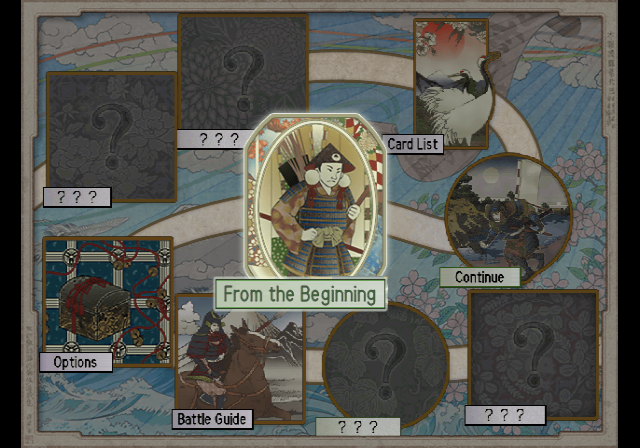
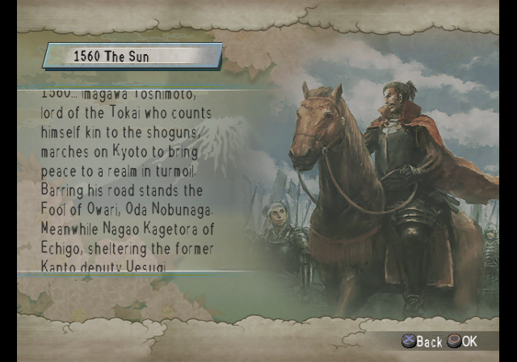
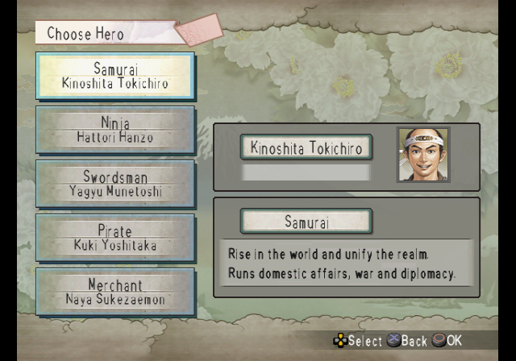
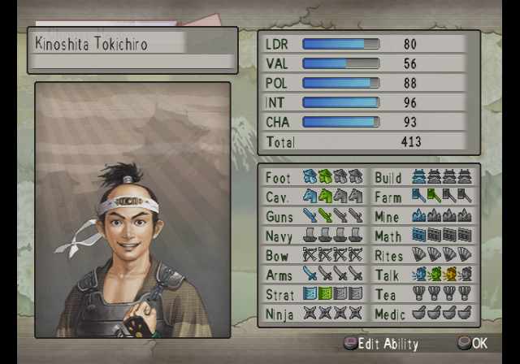
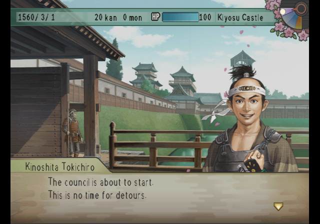
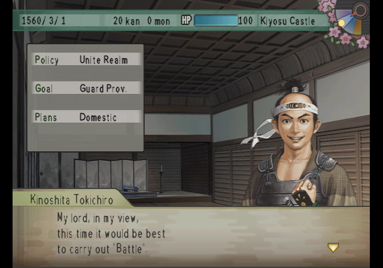
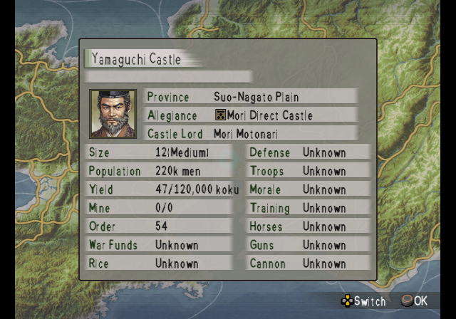
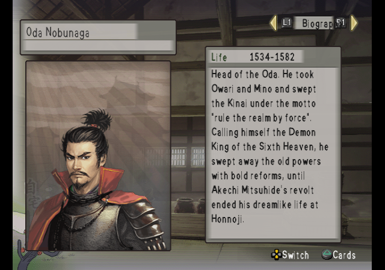
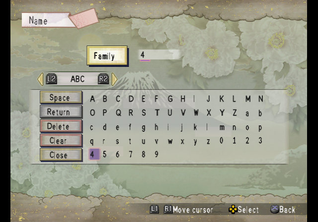

# Taiko Risshiden V — English Translation

A fan translation of **Taiko Risshiden V** (太閤立志伝V, Koei, 2004) for the
PlayStation 2 into English. Taiko Risshiden is Koei's Sengoku-era life simulation:
you live as a samurai, merchant, ninja, swordsman or pirate and rise in the world.
The game was only released in Japan.

> **This is a full machine translation.** All of the game's text was translated from
> Japanese by an AI model, not by a human translator, and it has not been
> proofread by a fluent Japanese speaker. Expect occasional mistranslations, awkward
> phrasing and inconsistent terms. Corrections are welcome.

> **This is a beta (v0.9).** Menus, system text, names and most dialogue are in
> English, but the story event scenes are still in Japanese. They will follow in a
> later release.

This repository contains the English text and the tools that build the patch.
It does **not** contain the game, any of its data, or the Japanese script — you need
your own copy of the game.

## Screenshots

| | | |
|:-:|:-:|:-:|
|  |  |  |
| Main menu | Scenario introduction | Hero select |
|  |  |  |
| Abilities | Dialogue | Council |
|  |  |  |
| Castle information | Officer history | English name entry |

## What's translated

- All of the game's message text: town and job dialogue, commands, missions, councils,
  battles and the battle advisor, the tea party, mini-games, help pages and guides,
  item, card and town descriptions, and all officer biographies
- Menus, labels and system messages, including memory card messages
- About 1,200 officer and character names, romanised (names shared with *Nobunaga's
  Ambition DS 2* use the same spelling), plus towns, castles, provinces, items, titles,
  ranks and missions
- Scenario titles and introductions
- Graphics: main-menu cards, banners, buttons and labels, redrawn at build time with an
  original English font
- A proportional English font with word wrap, and longer message lines
- **English name entry**: new officers are named with a letter grid (A–Z, a–z, 0–9)

**Not yet translated:** the story event scenes (opening, tutorials and historical
events), which are written into the game's event scripts. During these scenes you
will see Japanese text, sometimes mixed with English names and words.

Long names and labels are shortened where the game's boxes are too small.

## Applying the patch (players)

1. Download the release zip (`Taiko_Risshiden_V_English_v<version>.zip`) from the
   Releases page. It contains the patch, `taiko_risshiden_5_en_v<version>.xdelta`.
2. You need an unmodified image of the Japanese disc (serial `SLPM-65674`):

   | | |
   |---|---|
   | Size  | 1,555,234,816 bytes |
   | CRC32 | `FC665CCE` |
   | MD5   | `2add4b7c455c8641543a4f6201f9dc23` |
   | SHA-1 | `9d8bc973f6dca388a6982bc55d1ff76e0c9e34d3` |

3. Apply it with an xdelta tool, e.g. [Delta Patcher](https://github.com/marco-calautti/DeltaPatcher)
   or the command line:

   ```
   xdelta3 -d -s taiko_risshiden_5.iso taiko_risshiden_5_en_v<version>.xdelta taiko_risshiden_5_en.iso
   ```

The patched image has the same serial, so it uses the same memory card saves as the
Japanese game.

## Building from source

Requirements: Python 3.10+, `xdelta3` (for the patch file).

```
python -m venv .venv
.venv/bin/pip install -r requirements.txt
cp /path/to/your/disc.iso taiko_risshiden_5.iso   # must match the checksums above
.venv/bin/python tools/setup.py                   # extracts script/ from your disc, applies tl/
.venv/bin/python tools/build.py                   # writes build/taiko_risshiden_5_en.iso + .xdelta
```

`tools/setup.py` checks the disc's SHA-1 and generates `script/`, which pairs the
Japanese text from your disc with the English from `tl/`. `script/` and `build/` are
never committed. Re-run `setup.py` after editing anything in `tl/`.
The build is reproducible: the same disc and sources give a byte-identical patch.

To make a release package, run `.venv/bin/python tools/package.py 0.9` after building:
it writes `release/<name>_v0.9.zip` with the versioned xdelta patch and a plain-text
README.txt. The disc image itself is never packaged.

## Repository layout

| Path | Contents |
|---|---|
| `tl/msgNN.txt` | English for each message block of TAI5MSG.DAT, by entry number (`@N`) |
| `tl/ui.txt`, `tl/elfstr.txt` | English for strings in the game program, by index or address |
| `tl/tables/` | English for the program's name tables (towns, items, offices, ...) |
| `tl/names_persons.json`, `tl/names_pool.txt` | English officer and character names |
| `tl/scenarios.txt`, `tl/menu.txt`, `tl/gfx.txt` | Scenario titles and intros; text drawn into graphics |
| `tools/setup.py`, `tools/build.py` | Create `script/`; build the patched disc and the patch |
| `tools/tl.py` | Validates and word-wraps translations (`apply`, `show`, `stats`) |
| `tools/iso.py`, `datafile.py`, `msgfile.py`, `msgscript.py`, `text.py` | Disc image, archive and message formats |
| `tools/vwf.py`, `latinfont.py`, `msgwindow.py`, `msgbuf.py` | Proportional font, message window and buffer patches |
| `tools/names.py`, `nameplate.py`, `nameentry.py` | English names in the game, speaker plates, English name entry |
| `tools/ui.py`, `elfstr.py`, `elftables.py`, `elfseg.py`, `battlename.py`, `scenarios.py` | Program text and the English data segment |
| `tools/tk5p.py`, `gfx.py`, `menugfx.py` | Texture format (decoder and compressor) and redrawn graphics |
| `tools/package.py` | Makes the release zip (patch + README.txt with checksums) |
| `tools/dev/`, `tools/emu/` | Development helpers (disassembly, PCSX2 automation) |

## Known issues

- **Story event scenes are still in Japanese** (see above). Some names in them are cut
  short (e.g. "Tokichir").
- **Thin vertical lines between letters when PCSX2 upscales.** At native resolution
  the text is clean. In PCSX2, open the game's Properties >
  Graphics, enable manual hardware fixes, and set **Round Sprite** to **Full**
  (in the Upscaling Fixes tab).
- The name plate next to the hero's portrait at home cuts long names and repeats their
  first letters.
- Officer and castle lists may be sorted by the Japanese reading of names.
- Some vertical labels drawn in calligraphy (location names, town facility cards) are
  left in Japanese.
- The reading fields in name entry still take Japanese kana.

Tested in PCSX2 only. Bug reports with a screenshot and where it happened are welcome.

## Credits

- Translation and hacking: [damon-daemon](https://github.com/damon-daemon)
- Taiko Risshiden V © Koei Tecmo. This is an unofficial fan project, not affiliated
  with or endorsed by Koei Tecmo. Please support the official releases.

## License

The tools, fonts, documentation and English translation text in this repository
are released under the [MIT License](LICENSE). This covers only original work in
this repository: the game itself and all of its content (code, Japanese text,
graphics, audio) are copyright Koei Tecmo and are not included or licensed here.
